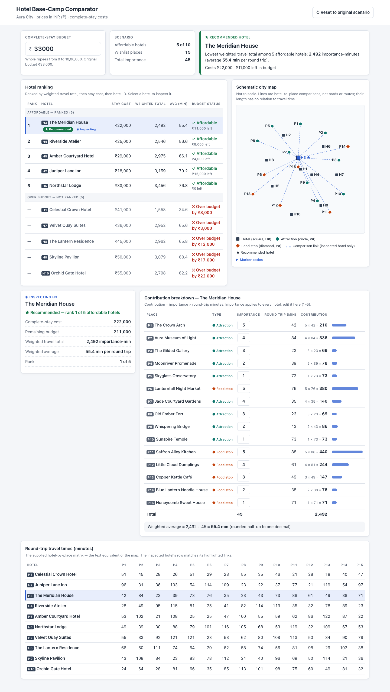

# Hotel Base-Camp Comparator

A client-side React application that helps a group choose the **most accessible hotel they can afford** for a city trip. It compares 10 hotels against a 15-place wishlist using importance-weighted round-trip travel times, filters by a complete-stay budget, ranks the affordable hotels, recommends one, and shows exactly how every number was calculated.

The bundled demonstration city is **Aura** (currency INR, initial budget ₹33,000). The application is a deterministic comparison tool — not a navigation, routing or itinerary app. All data is local; there is no backend, database or external API.



## Features

- **One-action loading** — a single "Load Aura City" button loads all hotels, places, importance values, the 10 × 15 travel-time matrix, map positions and the budget.
- **Editable budget** with immediate recalculation of affordability, shortfalls, ranks and the recommendation.
- **Editable importance (1–5)** for every wishlist place, recalculating contributions, totals, averages, ranks and the recommendation.
- **Ranking of all 10 hotels** — affordable hotels in rank order; over-budget hotels stay visible, unranked, with "Over budget by ₹X".
- **Recommendation** of the rank-1 affordable hotel, or `NO_AFFORDABLE_HOTEL` when nothing fits.
- **Hotel inspection** — select any hotel (including over-budget ones) to see its cost, budget status, totals, rank and all 15 contributions. Inspecting never changes the ranking.
- **Contribution breakdown** — `importance × minutes = contribution` for each place, with a bar for scale and the average formula.
- **Schematic SVG map** — 25 labelled markers (10 hotels, 9 attractions, 6 food stops) and only the inspected hotel's 15 comparison links. Links are comparisons, not routes.
- **Travel-time table** — the full supplied 10 × 15 matrix, the map's accessible text equivalent.
- **Validation** — invalid budget or importance input is rejected with a visible message; all derived results are hidden so nothing stale is shown.
- **Reset** — restores the original budget, importance values, inspected hotel and results.
- Status is conveyed with text and symbols (★ ✓ ✕ ◉), not colour alone.

## Technology

| Technology | Purpose |
|---|---|
| React 19 | User interface |
| Vite 8 | Dev server and production build |
| JavaScript (ES modules) | Application and business logic |
| Plain CSS | Styling (`src/index.css`) |
| Custom SVG | Schematic map |
| Vitest 3 + React Testing Library + jsdom | Unit, hook and UI tests |
| oxlint | Linting |
| Python 3 (test tooling only) | Independent verification of the expected-results fixture |

No state-management, charting or mapping libraries are used.

## Architecture

A lightweight four-layer client-side architecture:

```text
Data layer            src/data/cityData.json          static Aura dataset (never modified)
        │
Domain layer          src/domain/                     pure JavaScript, no React
                        validation.js                   validates the whole scenario + inputs
                        calculations.js                 contributions, totals, rounding
                        ranking.js                      affordability, ranking, compareHotels()
        │
Application layer     src/hooks/useComparator.js      useState + useMemo, user actions
        │
Presentation layer    src/components/                 React components + SVG map
```

Data flows one way: the hook holds only the editable inputs (loaded city, budget text, importance values, selected hotel) and derives everything else by calling `compareHotels(city, budget, importance)`. That single function validates first and returns no ranking, recommendation or contributions if anything is invalid. Components receive plain props and never calculate results.

Expected results live in `tests/fixtures/expectedResults.json` and are used only by tests — never imported by application code.

See [docs/design-decisions.md](docs/design-decisions.md) for the reasoning behind these choices.

## Project structure

```text
├── data/dataset.json                  original supplied dataset
├── docs/
│   ├── requirements.md                requirements specification
│   ├── architecture.md                architecture document
│   ├── implementation-plan.md         staged implementation plan
│   ├── design-decisions.md            decisions, reasoning, alternatives
│   ├── test-plan-and-results.md       test plan, traceability, results
│   ├── ai-interaction-log.md          record of AI-assisted development
│   ├── screenshots/                   screenshots of the running app
│   └── test-evidence/                 saved test, lint, build and verification output
├── src/
│   ├── data/cityData.json             runtime copy of the dataset
│   ├── domain/                        validation.js, calculations.js, ranking.js
│   ├── hooks/useComparator.js         application state
│   ├── components/                    Dashboard, BudgetControl, HotelRanking, HotelDetails,
│   │                                  ContributionBreakdown, SchematicMap (+ TravelTimeTable), format.js
│   ├── App.jsx, main.jsx, index.css
├── tests/
│   ├── fixtures/expectedResults.json  independently calculated expected results
│   ├── fixtures/verify_expected_results.py
│   ├── validation.test.js, calculations.test.js, ranking.test.js
│   ├── useComparator.test.jsx, Dashboard.test.jsx, boundaries.test.js
│   └── testScenarios.js, setup.js, setup.test.js
├── index.html, vite.config.js, package.json
```

## Getting started

Requires **Node.js 20.19+ or 22.12+** (Vite 8 requirement) and npm.

```bash
npm install
```

Start the development server, then open http://localhost:5173 and click **Load Aura City**:

```bash
npm run dev
```

Run the full test suite once:

```bash
npm run test:run
```

Run tests in watch mode:

```bash
npm test
```

Lint:

```bash
npm run lint
```

Production build (output in `dist/`) and local preview:

```bash
npm run build
```

```bash
npm run preview
```

Verify the expected-results fixture against the dataset with the independent Python calculation (optional, needs Python 3):

```bash
python3 tests/fixtures/verify_expected_results.py
```

## How the comparison works

For every hotel *h* and wishlist place *p*, using only the supplied importance values and round-trip minutes:

| Quantity | Formula |
|---|---|
| Contribution | `importance(p) × round_trip_minutes(h, p)` |
| Weighted travel total | sum of the 15 contributions for hotel *h* (an exact integer) |
| Importance total | sum of all 15 importance values (45 in the original scenario) |
| Weighted average | `weighted travel total ÷ importance total` |

**Rounding.** The average is displayed to one decimal place using round-half-up, computed with integers only:
`tenths = floor((20 × total + importanceTotal) / (2 × importanceTotal))`, displayed as `tenths / 10`. This avoids floating-point errors (for example 28.05 being stored as 28.0499…). Display rounding never affects ranking.

**Affordability.** A hotel is affordable when `stay_cost ≤ budget` — equality counts. Affordable hotels show the remaining budget (`budget − stay_cost`); over-budget hotels show `Over budget by (stay_cost − budget)`.

**Ranking.** Only affordable hotels are ranked, by:
1. weighted travel total, ascending (the exact integer, not the rounded average);
2. stay cost, ascending;
3. hotel ID, ascending ASCII order.

Ranks run 1, 2, 3… without gaps. Over-budget hotels get no rank.

**Recommendation.** The rank-1 hotel. If no hotel is affordable, the result is `NO_AFFORDABLE_HOTEL` — a valid outcome, not an error.

**Validation.** Before any calculation the whole scenario is checked: 2–10 hotels and 3–15 places; IDs matching `^[A-Z][A-Z0-9_-]{0,15}$` and unique across city, hotels and places; non-empty names; place type `attraction` or `food`; budget 0–1,000,000, stay cost 1–1,000,000, importance 1–5 and travel time 1–600, all whole numbers; every hotel mapping exactly the wishlist's place IDs; map coordinates within 0–100. Map coordinates are used only to draw the map, never in calculations.

## Demonstration scenarios

| Scenario | Result |
|---|---|
| Initial (₹33,000) | 5 affordable hotels. **The Meridian House** recommended — total 2,492, average 55.4 min, ₹22,000, ₹11,000 left. Celestial Crown Hotel is the most accessible overall (1,558) but over budget by ₹8,000. |
| Budget ₹41,000 | Celestial Crown Hotel becomes affordable at exactly its cost and is recommended; 7 affordable hotels. |
| Budget ₹40,999 | Celestial Crown Hotel is over budget by ₹1, unranked; The Meridian House is recommended again. |
| The Gilded Gallery importance 3 → 2 | Importance total 44; **Riverside Atelier** recommended (2,451 vs 2,469). |
| Budget ₹17,999 | `NO_AFFORDABLE_HOTEL`; every hotel shows its shortfall. |

Every value above is checked by automated tests against `tests/fixtures/expectedResults.json`. Test results and evidence: [docs/test-plan-and-results.md](docs/test-plan-and-results.md).
