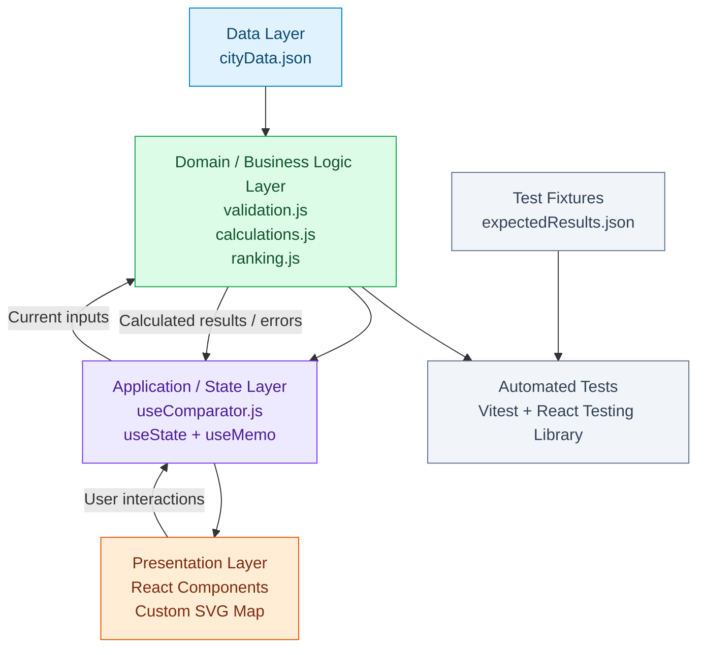
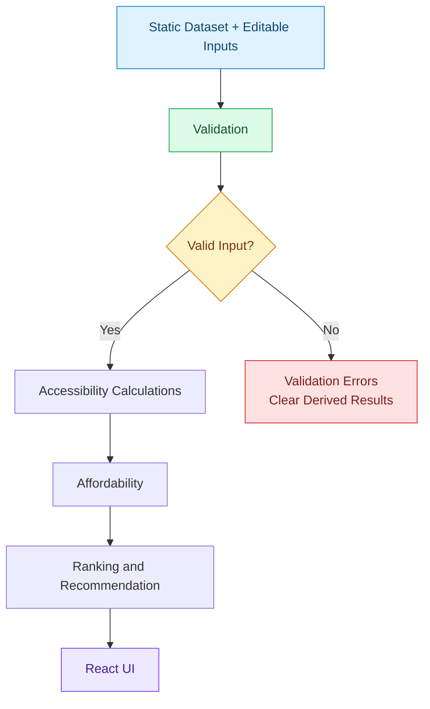

# Hotel Base-Camp Comparator — Architecture Document

## 1. Architectural Overview

### 1.1 Architecture Style

The Hotel Base-Camp Comparator uses a **lightweight four-layer client-side architecture**.

The architecture separates data, business logic, application state, and presentation responsibilities while keeping the implementation simple and maintainable.

The four layers are:

1. **Data Layer:** Stores the static city dataset and initial configuration.
2. **Domain / Business Logic Layer:** Validates inputs and performs accessibility, affordability, and ranking calculations.
3. **Application / React State Layer:** Manages user interactions and connects the business logic with the UI.
4. **Presentation Layer:** Displays the dashboard, hotel comparisons, contribution breakdown, and schematic map.

The calculation engine is independent of React and SVG. This ensures that business rules can be tested independently and modified without affecting the presentation layer.

### 1.2 Architecture Diagram



The test fixtures are intentionally separate from the application data flow. They are used only to verify the correctness of calculated results.

---

## 2. Final Technology Stack

| Technology | Purpose |
|---|---|
| React.js | Component-based user interface |
| Vite | Development server and build tooling |
| JavaScript | Application and business logic |
| CSS or Tailwind CSS | Application styling |
| Static local JSON | Deterministic hotel, wishlist, and travel-time data |
| Custom SVG | Schematic city map and comparison links |
| Vitest | Automated unit testing |
| React Testing Library | Essential UI interaction testing |

### 2.1 Architectural Constraints

The application is entirely client-side.

It will not use:

- Backend services.
- Databases.
- External APIs.
- Live map services.
- Geocoding services.
- External travel-time calculation services.
- Unnecessary state-management libraries.
- Unnecessary architectural dependencies.

All application data is available locally and all calculations are performed in the browser.

---

## 3. Final Project Structure

The project will follow this agreed structure:

```text
src/
├── data/
│   └── cityData.json
│
├── domain/
│   ├── validation.js
│   ├── calculations.js
│   └── ranking.js
│
├── hooks/
│   └── useComparator.js
│
├── components/
│   ├── Dashboard.jsx
│   ├── BudgetControl.jsx
│   ├── HotelRanking.jsx
│   ├── HotelDetails.jsx
│   ├── ContributionBreakdown.jsx
│   └── SchematicMap.jsx
│
├── App.jsx
└── main.jsx

tests/
├── fixtures/
│   └── expectedResults.json
├── validation.test.js
├── calculations.test.js
└── ranking.test.js
```

### 3.1 Data Layer

**File: `src/data/cityData.json`**

Contains the static application input:

- City information.
- Initial budget.
- Hotel details and stay costs.
- Wishlist places and their importance values.
- Deterministic hotel-to-place round-trip travel times.
- Hotel and wishlist-place map coordinates.

The dataset is the source of truth for the application's initial scenario.

It must not contain precomputed rankings, recommendations, or expected weighted totals.

### 3.2 Domain / Business Logic Layer

**`validation.js`**

Responsible for validating:

- Hotel and wishlist-place counts.
- Unique and correctly formatted IDs.
- Non-empty names.
- Supported wishlist-place types.
- Importance values.
- Budget and hotel stay costs.
- Complete hotel-to-place travel-time mappings.
- Valid travel-time ranges.
- Missing or unexpected place IDs in hotel mappings.

It validates both the static dataset and the current editable inputs.

Invalid input must prevent the calculation pipeline from producing results.

**`calculations.js`**

Responsible for accessibility calculations:

- Weighted contribution for every hotel-place pair.
- Weighted travel total for each hotel.
- Total wishlist importance.
- Weighted average travel time.
- Correct round-half-up display rounding.

It receives validated input and returns calculated accessibility results.

It does not determine affordability or hotel ranking.

**`ranking.js`**

Responsible for:

- Determining hotel affordability.
- Calculating remaining budget.
- Calculating budget shortfalls.
- Excluding over-budget hotels from ranking.
- Sorting affordable hotels.
- Assigning consecutive ranks.
- Selecting the recommended hotel.
- Handling the no-affordable-hotel scenario.

Ranking uses exact weighted travel totals, not displayed averages.

### 3.3 Application / React State Layer

**File: `src/hooks/useComparator.js`**

This custom hook connects the React interface with the domain calculation modules.

Its responsibilities include:

- Maintaining the current budget.
- Maintaining current wishlist-place importance values.
- Maintaining the selected hotel ID.
- Triggering validation and calculations when relevant inputs change.
- Exposing calculated results to the components.
- Handling reset functionality.
- Exposing validation errors and invalid states.

The hook keeps application state centralized without introducing an external state-management library.

### 3.4 Presentation Layer

**`App.jsx`**

Acts as the root application component and initializes the dashboard.

**`Dashboard.jsx`**

Arranges the main application interface and its sections.

**`BudgetControl.jsx`**

Displays the current budget and allows the user to modify it.

**`HotelRanking.jsx`**

Displays the affordable hotels in ranking order, including their costs, accessibility totals, averages, and eligibility information.

**`HotelDetails.jsx`**

Displays information about the currently inspected hotel.

**`ContributionBreakdown.jsx`**

Displays the 15 wishlist-place contributions for the selected hotel, including importance, round-trip time, and weighted contribution.

**`SchematicMap.jsx`**

Renders the custom SVG map containing:

- Hotel markers.
- Wishlist-place markers.
- Selected-hotel comparison links.
- Relevant visual highlighting and comparison information.

The map is a presentation component and does not perform business calculations.

**`main.jsx`**

Provides the React application entry point.

### 3.5 Test Layer

**`expectedResults.json`**

Stores independently calculated expected values for the main demonstration scenario and verification scenarios.

It is used exclusively by automated tests.

It must never be imported into application code or used as an input to the ranking engine.

**Test files**

- `validation.test.js`: Tests dataset and editable-input validation.
- `calculations.test.js`: Tests accessibility formulas and rounding.
- `ranking.test.js`: Tests affordability, sorting, tie-breakers, and recommendations.

---

## 4. Business Logic Design

All business logic is implemented as pure JavaScript functions.

These functions:

- Accept input arguments.
- Return calculated results.
- Do not modify the original dataset.
- Do not depend on React state.
- Do not access the DOM.
- Do not use SVG coordinates.
- Can be tested independently.

### 4.1 Validation — `validation.js`

Validation takes place before calculations.

The application must validate:

| Validation | Requirement |
|---|---|
| Hotel count | 2–10 |
| Wishlist-place count | 3–15 |
| IDs | Globally unique and match the required pattern |
| Names | Non-empty after trimming |
| Place types | `attraction` or `food` |
| Importance | Integer from 1 to 5 |
| Budget | Valid assignment-defined budget range |
| Hotel stay cost | Integer from 1 to 1,000,000 |
| Travel time | Integer from 1 to 600 |
| Travel mapping | Exactly one valid entry for every wishlist place per hotel |

Validation must identify invalid fields or mappings clearly.

If validation fails:

1. Stop the calculation pipeline.
2. Return validation errors.
3. Clear stale weighted contributions.
4. Clear stale rankings.
5. Clear the previous recommendation.
6. Clear derived map comparison highlights.

No partial or stale results should be displayed.

### 4.2 Accessibility Calculations — `calculations.js`

Every hotel is compared against every wishlist place.

All wishlist places participate in every baseline comparison.

**Weighted contribution**

For hotel \(h\) and place \(p\):

\[
Contribution(h,p) = Importance(p) \times RoundTripMinutes(h,p)
\]

**Weighted travel total**

\[
WeightedTotal(h) =
\sum_{p=1}^{n} Contribution(h,p)
\]

**Total importance**

\[
ImportanceTotal =
\sum_{p=1}^{n} Importance(p)
\]

**Weighted average travel time**

\[
WeightedAverage(h) =
\frac{WeightedTotal(h)}{ImportanceTotal}
\]

The weighted travel total is an integer and is the authoritative accessibility value used for ranking.

**Display rounding**

Weighted averages must be displayed to one decimal place using round-half-up.

The display-rounding operation must not affect ranking or comparison.

### 4.3 Affordability and Ranking — `ranking.js`

**Affordability**

A hotel is affordable when:

\[
StayCost(h) \leq Budget
\]

A hotel exactly on the budget boundary is affordable.

**Remaining budget**

\[
RemainingBudget(h) = Budget - StayCost(h)
\]

**Budget shortfall**

For an over-budget hotel:

\[
Shortfall(h) = StayCost(h) - Budget
\]

Over-budget hotels remain visible but are excluded from ranking and recommendation.

**Ranking order**

Affordable hotels are sorted by:

1. Weighted travel total ascending.
2. Stay cost ascending.
3. Hotel ID ascending ASCII order.

Ranks are consecutive, beginning at 1.

The first-ranked affordable hotel is the recommended hotel.

**No affordable hotels**

If no hotel satisfies the budget:

- Return `NO_AFFORDABLE_HOTEL`.
- Keep all hotels visible.
- Display each hotel's budget shortfall.
- Do not assign numerical ranks.
- Do not recommend a hotel.

This is a valid application result, not a validation error.

---

## 5. React State Management

### 5.1 Final Decision

Use React's built-in `useState` and `useMemo` where useful, encapsulated inside `useComparator.js`.

No Redux, Zustand, or Context API will be introduced.

The application has a small amount of changing state, so React's built-in state management is sufficient.

### 5.2 State to Maintain

Only the following values should be stored as changing application state:

| State | Purpose |
|---|---|
| Current budget input | Stores the user's current budget value |
| Current importance values | Stores the current importance of each wishlist place |
| Selected hotel ID | Identifies the hotel currently being inspected |

The original dataset remains immutable.

### 5.3 Derived Values

The following values must be derived through the calculation pipeline rather than maintained as duplicate state:

- Weighted contributions.
- Weighted travel totals.
- Total importance.
- Weighted averages.
- Affordability.
- Remaining budget.
- Budget shortfalls.
- Hotel rankings.
- Recommended hotel.

This avoids inconsistent state and ensures that changes to inputs propagate to every dependent result.

`useMemo` may be used to avoid unnecessary recalculation when dependencies have not changed. It is an optimization rather than a requirement for correctness.

### 5.4 Budget Changes

When the user changes the budget:

1. Update the budget state.
2. Validate the new budget.
3. Recalculate affordability.
4. Recalculate remaining budgets and shortfalls.
5. Recalculate hotel rankings.
6. Update the recommendation.

Accessibility contributions, weighted totals, and averages do not change because neither travel times nor importance values have changed.

### 5.5 Importance Changes

When the user changes a wishlist-place importance:

1. Update the importance state.
2. Validate the updated importance values.
3. Recalculate contributions for all hotels for that place.
4. Recalculate all weighted travel totals.
5. Recalculate weighted averages.
6. Recalculate hotel rankings and recommendation.
7. Update the contribution breakdown and relevant map information.

### 5.6 Hotel Inspection

Selecting a hotel updates the selected hotel ID.

The selected hotel determines:

- Which hotel is highlighted on the map.
- Which 15 comparison links are displayed.
- Which travel-time and contribution values are inspected.
- Which hotel details are shown.

Hotel inspection does not change the underlying ranking or accessibility calculations.

### 5.7 Reset

Reset restores the original scenario from the static dataset:

- Original budget.
- Original wishlist-place importance values.
- Default inspected hotel.
- Original derived results and recommendation.

Reset is handled through the custom hook rather than reloading the application.

### 5.8 Invalid Input Handling

The current editable input must be preserved sufficiently to display and correct the user's entry.

If an input is invalid:

- Display a clear validation message.
- Do not produce partial calculations.
- Clear stale contributions, ranks, and recommendations.
- Remove derived comparison highlights.
- Allow the user to correct the input.

UI input restrictions are not a substitute for domain validation.

---

## 6. Calculation and Data Flow

### 6.1 Calculation Pipeline

The application follows this sequence:



### 6.2 Important Data Flow Rules

**Invalid input**

Invalid input stops the pipeline before accessibility or ranking results are produced.

The application must not display stale or partially calculated results.

**No affordable hotel**

No affordable hotel is a valid result. The pipeline completes and returns a result with no recommendation or numerical ranks.

**Budget change**

A budget change affects affordability, shortfalls, ranking, and recommendation.

It does not affect travel contributions or weighted accessibility totals.

**Importance change**

An importance change affects contributions for the corresponding place across all hotels, weighted totals, weighted averages, rankings, and recommendation.

**Hotel inspection**

Hotel inspection only changes the selected hotel and its visual comparison details. It does not recalculate the ranking.

---

## 7. SVG Map Design

### 7.1 Map Implementation

The city map will be implemented using a custom SVG schematic.

It will display:

- 10 hotel markers.
- 15 wishlist-place markers.
- 15 comparison links for the currently selected hotel.

No external mapping library is required.

### 7.2 Map Layers

The SVG will visually organize the map into three logical groups:

| Layer | Responsibility |
|---|---|
| Place markers | Display the 15 wishlist locations |
| Hotel markers | Display the 10 hotel locations |
| Comparison links | Display the selected hotel's links to all 15 places |

The map should clearly distinguish hotel markers from attraction and food markers.

The selected hotel and its comparison links should be visually highlighted.

### 7.3 Comparison Links

When a hotel is inspected:

1. Identify its marker coordinates.
2. Identify the coordinates of all 15 wishlist places.
3. Draw one comparison link from the selected hotel to each place.
4. Associate each link with its supplied round-trip travel time.
5. Display the corresponding weighted contribution where appropriate.

The displayed travel time and contribution must come from the calculation results and source dataset.

### 7.4 Separation from Business Logic

Map coordinates are strictly presentation data.

They are used only to position markers and draw visual links.

The map must never calculate:

- Travel times.
- Accessibility totals.
- Weighted contributions.
- Hotel rankings.
- Recommendations.

The visual length of a line has no relationship to its supplied travel time.

All accessibility calculations use the deterministic hotel-to-place travel-time matrix.

---

## 8. Testing Strategy

### 8.1 Testing Approach

Testing will focus primarily on the pure business logic.

Vitest will be used for unit testing, with React Testing Library for essential UI interactions.

### 8.2 Test Fixture Separation

`tests/fixtures/expectedResults.json` contains independently calculated expected results.

It is used only by automated tests to verify the calculation engine.

The application must never import or depend on this file.

This ensures that the application calculates its own weighted totals, averages, affordability, rankings, and recommendation.

### 8.3 Unit Testing

**`validation.test.js`**

Test cases:

- Valid dataset.
- Invalid hotel and wishlist counts.
- Duplicate IDs.
- Invalid ID format.
- Empty names.
- Unsupported place types.
- Invalid importance values.
- Invalid budget and stay costs.
- Missing travel-time mappings.
- Unexpected travel-time mappings.
- Invalid travel-time values.

**`calculations.test.js`**

Test cases:

- Weighted contribution calculation.
- Weighted travel total.
- Total importance.
- Weighted average.
- Round-half-up display rounding.
- Importance changes update the correct contributions.
- Budget changes do not alter accessibility calculations.
- All wishlist places participate in every comparison.

**`ranking.test.js`**

Test cases:

- Correct affordability determination.
- Exact budget equality.
- Remaining budget.
- Over-budget shortfalls.
- Over-budget hotel exclusion.
- Ranking by exact weighted total.
- Tie-break by stay cost.
- Tie-break by hotel ID in ascending ASCII order.
- Displayed averages do not determine ranking.
- No-affordable-hotel scenario.
- Correct recommendation.
- Budget changes update ranking.
- Importance changes update ranking.
- Invalid results do not retain stale rankings.

### 8.4 UI Interaction Testing

React Testing Library will be used for essential interactions:

- Changing the budget updates affordability and ranking.
- Changing importance updates the contribution breakdown and recommendation.
- Selecting a hotel updates its inspection details and map highlighting.
- Reset restores the initial scenario.
- Invalid input displays an error and clears derived results.

### 8.5 Main Scenario Verification

The main Aura demonstration scenario must be verified against the independent expected results.

Verification includes:

- Initial hotel totals and averages.
- Initial affordability and ranking.
- Initial recommendation.
- Budget boundary scenario.
- Importance-change scenario.
- No-affordable scenario.
- Relevant validation and ranking edge cases.

Expected results are verification data, never ranking inputs.

---

## 9. Architecture Trade-offs and Decisions

### 9.1 Independent Business Logic vs Calculations Inside React Components

**Alternative A: Calculations inside React components**

Advantages:
- Less initial file organization.
- Can appear faster for a very small prototype.

Disadvantages:
- Components become responsible for both UI and business rules.
- Business logic is harder to test independently.
- Changes to formulas can affect presentation code.
- Repeated calculations can lead to inconsistent behavior.

**Alternative B: Independent pure JavaScript functions**

Advantages:
- Clear separation between business logic and UI.
- Easy to test without rendering React.
- Easier to debug and modify.
- Reusable across different presentation components.

Disadvantages:
- Requires some initial module organization.
- Introduces a small amount of additional structure.

**Final decision: Independent pure business logic.**

The accessibility and ranking rules are central to this assignment. Keeping them independent makes correctness easier to demonstrate and makes live modifications safer.

### 9.2 `useState` + Custom Hook vs Redux / Zustand

**Alternative A: React `useState` + `useComparator.js`**

Advantages:
- Built into React.
- Minimal setup.
- Easy to understand.
- Suitable for a small number of changing values.
- Keeps related application state and update functions together.

Disadvantages:
- Not intended for very large applications with complex shared state.
- More extensive state requirements could eventually need another approach.

**Alternative B: Redux or Zustand**

Advantages:
- Centralized state management.
- Useful for complex applications with extensive shared state.
- Can provide structured state-update workflows.

Disadvantages:
- Additional setup and dependencies.
- More concepts to understand and maintain.
- Unnecessary for the current application's state requirements.

**Final decision: React `useState` and `useMemo` inside a custom hook.**

The application only needs budget, importance values, and the selected hotel ID as changing state. An external state-management library would add complexity without meaningful benefits.

### 9.3 Custom SVG vs External Mapping Library

**Alternative A: Custom SVG schematic map**

Advantages:
- Lightweight.
- No mapping dependency.
- Complete control over markers and comparison links.
- Directly supports the required schematic representation.
- Easy to synchronize with React state.

Disadvantages:
- Marker rendering and visual interactions need to be implemented manually.
- Does not provide geographical mapping capabilities.

**Alternative B: External mapping library**

Advantages:
- Provides built-in geographical rendering and map interactions.
- Useful for applications requiring real-world maps.

Disadvantages:
- Adds dependencies and configuration.
- Introduces unnecessary capabilities.
- Does not improve the required deterministic comparison calculations.

**Final decision: Custom SVG.**

The assignment requires a schematic map with predetermined positions, not a real geographical map. A custom SVG is sufficient and keeps the implementation lightweight.

### 9.4 Avoiding Unnecessary Abstractions

The application will not introduce:

- Repository patterns.
- Dependency injection.
- Backend-style service layers.
- API clients.
- Generic data-access abstractions.
- External state-management frameworks.
- Unnecessary component or utility hierarchies.

The application reads one local JSON dataset and runs deterministic calculations in the browser.

Straightforward modules and pure functions are sufficient.

The objective is to maintain clear responsibilities without introducing abstractions that make the application harder to understand or modify.

---

## 10. Important Assignment Constraints

The implementation must preserve the following requirements.

### 10.1 Dataset Constraints

- The calculation engine supports 2–10 hotels.
- The calculation engine supports 3–15 wishlist places.
- The main demonstration scenario contains exactly 10 hotels and 15 wishlist places.
- The main scenario contains exactly 150 hotel-to-place travel-time entries.
- All travel times are deterministic and stable.
- All 15 wishlist places participate in every baseline comparison.
- Map positions are presentation data only.

### 10.2 Calculation Constraints

For each hotel:

- Calculate every place's weighted contribution.
- Calculate the exact weighted travel total.
- Calculate the weighted average using total wishlist importance.
- Display the average to one decimal using round-half-up.

Display rounding must never affect ranking.

### 10.3 Ranking Constraints

Affordable hotels must be ranked using this exact order:

1. Weighted travel total ascending.
2. Stay cost ascending.
3. Hotel ID ascending ASCII order.

Additional rules:

- A hotel exactly on budget is affordable.
- Over-budget hotels remain visible but are not ranked.
- The recommended hotel is the first-ranked affordable hotel.
- If no hotels are affordable, no numerical ranks or recommendation are displayed.

### 10.4 Input and Expected-Result Separation

The application input is:

`src/data/cityData.json`

The independent expected results are:

`tests/fixtures/expectedResults.json`

The expected results must never influence calculations, affordability, ranking, or recommendation.

### 10.5 Deterministic Behavior

For the same valid dataset, budget, and importance values, the application must always produce the same calculated results and ranking.

No randomness, external API responses, map geometry, or live data may influence the calculation engine.

---

## 11. Final Architectural Decisions Summary

| Area | Final decision |
|---|---|
| Architecture | Lightweight four-layer client-side architecture |
| Data | Static local JSON |
| Business logic | Independent pure JavaScript functions |
| Validation | Centralized in `validation.js` |
| Accessibility | Centralized in `calculations.js` |
| Affordability and ranking | Centralized in `ranking.js` |
| React state | `useState` + `useMemo` where useful |
| State organization | One custom hook: `useComparator.js` |
| UI | Small, focused React components |
| Map | Custom SVG schematic |
| Testing | Vitest + React Testing Library |
| Expected results | Test fixture only |
| Backend | None |
| Database | None |
| External APIs | None |
| Additional abstractions | Avoided |

## 12. Conclusion

The proposed architecture prioritizes simplicity, correctness, testability, and ease of modification.

The four-layer separation keeps the calculation engine independent from the UI, while React's built-in state management handles the limited interactive state.

A static JSON dataset ensures deterministic inputs, and the custom SVG map provides the required visual comparison without introducing mapping dependencies.

The implementation deliberately avoids enterprise-level abstractions and unnecessary libraries.

The final design is appropriate for a one-day SDE Intern assignment and is structured to remain understandable, testable, and easy to modify during a live interview.
